<!--
  reading the source? respect. every visual here is a hand-built animated SVG in /assets —
  no templates, no JS, just SMIL + CSS keyframes.  0x4B495241
-->

  

  
  
  

 

  

  

 

<h3 align="center"><code>[ LIVE DISSECTION ]</code></h3>

  

 

<h3 align="center"><code>[ OBSESSIONS ]</code></h3>

  

<h3 align="center"><code>[ CASE FILES ]</code></h3>

  
  
  
  
  
  

<code>▸ classified files (8 more)</code>

 

  
  
  
  
  
  
  
  

<h3 align="center"><code>[ BODY COUNT ]</code></h3>

  
   
  

<h3 align="center"><code>[ ARSENAL ]</code></h3>

  
   
  
   
  

  
  
  
  <img src="https://img.shields.io/badge/Ghidra-0b0f17?style=for-the-badge&logo=data%3Aimage%2Fpng%3Bbase64%2CiVBORw0KGgoAAAANSUhEUgAAAEAAAABACAYAAACqaXHeAAALp0lEQVR42s2baYxdZRnHf%2Bfcc2%2BnM9MNpy3dKDOsgqW2LiVUC6IfqkYUEkSjSJRoSY0xqGmMn3BJUBMXFI2AAZdo0ogaoCAFscSlQUotEZGqdJEu09qhM8NM587MXY4f7v8tjy%2FnrueM4SY3dzv3fd9n%2Bz%2FP83%2FfE8Rcyww9AiDW%2B9lARZ9LTf4XAVU9C7o%2B9sbL7BHNgOCRWXBZ3xXb%2BH%2FZvLfC54HpV6sCrHViWTuLhx3TCp%2FTd9W0E4QZCZ83nyszFE72GWcVDlEGVo9nwDV9QeMEzwiywIWow8UVZOny%2F0nogtzd%2FV72fs%2FpWW43LKIO47KURfwZwfGEXgRcAFyoDJI34TUhUD0CPAscNxkmmEkPyJn4rs5QqnwL8GFgA7BCcyY9BoGTwPPAT4HfAWNaV5SQTTJRQJBxLnZjFYBLgU8CVwFdnrfFAutDwH3A34ETwp0yMAQsBEZN%2FRBm6QE27rJ6hFpoP7AZuEFCODcPjQJCYCtwF%2FCiifNuYBbwWl2zQV7wIDBu5kilgJkoQAIt7E3Al4CNnuA2x4fAV4GfyVPmAmuBy4HzgZVAjzf%2Bn4F3KURCPcudKiDKUPjAvK4Dbgfe4AmOwZgc8HXgDuAS4G3Au4HzEsaumtd1wMNS7EgaD8i3ULe3iu42ptcY4csJa3DC3w%2F8BPg8cC1whhmj6hVGoQmtsrzrAYFqpRF2hQ0UU84wrbnvXi%2B3rye8i%2FmjwC%2BlgE0SvmIEz%2Bm6oMHaLwN%2BbMIgn3R91KTCS1O%2FR2aRU8By4Ea5cbmJ9xWBbwB9ujbXICXWM2wFeI2AciLBG2vCJrTDhQ7j3ml3BXClrDYGDCtVnQnco%2FGDFouWaop%2BpQIcBE4B75RXvSIzJFkhjfBLgI8DWyQoys%2BTuqarxYotzqBZywHn6P3twDVJ84be%2B0KKgqYHWA98yhtnHrBY5W2r5WpQz2U7CMcycLWySMUPpTDD9DZfqDtPn58xhEbcZq0%2BYcKkmkGDBfCVpGwQevE2nQL0FqikraoS%2B4W0HbQR805R48BtKnnDlErI6f%2BXCZuq1gts%2FgxSuH9eldkFGusxYE8HHuYsvkhV3nXAXoPqaZmlm428kVVAkEIBCGzWyP2PynoDHVrOWex9qvpuUNubS%2BEJrrx%2Bh%2FqP0%2B18aCqpagexVVXaWwK8R7%2FtU7FzW4dKtaHwAeHBFvX9abrRimqCq633h210eoGHzoE6scXAh1SvV4G3CgxJoQA311nqEo%2BpG0wDim4tVxnMC8Im6SZIKG0jYJm6ssXK%2BzeaoiULttbNOVdjzgF%2BK1B0xEylTW9wsq4VxlSBWVGLbE2o%2FvsM%2FbkfWAW811g%2B9BZfSQGuzsNGVRb3KjM8qjl7OqgWnffMUU%2FyCDAdNVlEr6y9VAi%2FGrgYuEh1dtICql57O2Yor6hN1N6n8HQkyLdFjlykUFundcRtltZrpIB8lFD7O9a3X8TDlcqhS7wqquK1onaCMWCHMkK%2F%2FtevbNFOQfQccECubx8PAD%2BUF94EvL9FT3DzXlKP8HAXrFEO3iTLHffysGVurEJywDbgO7LaPcrnSYto5v4TYndOejHssGhISj4orNjYRjgs02spNG7pAGyFippPqHn5p2KvZNrSwIsr99tzYnEGpcCVXjlMi3uDIbAd2Gk8zRGelmMI5SE3A%2FuNDK2AawDENv87MqJPqaJbk58vqronAd3LhmwYAm4RDVUGXjJjNiq0YkN2OCbqWXVwg008xZW1e4E7PVmatey9QBx5Oy6zgbMV%2B3HCRKEhM34g7m2N%2BoCnlK9fUGN0OAEj6i3KYcu4OP7vAn%2BS9zQrflzI3At8TAZr5m15N6ePyrOF9n3eJoNb4BOm4XlS8Tdkrtun1IVc8rDiLSk2neL%2FJVALgV36%2FA%2BxSK1Ufm6cA0L2gRbZ7uB%2FmgKjzXOM6z4I%2FFyfB4HPAA%2Fpt%2FXK0bvksn%2Bgtl0VSgn7RWzWE8JZbhvwLeCbwG%2BA3coi7ZS9gTHKcAv%2FGxNJ8wqruEMNgaywRaksMDn5VvF1ReXjt8t1q96iBwWehxIyRqzvRgR0o%2FKWkQ5Pg7hrTyhjlRt4CwrTIhBGHrBVZU2AXwvI9mjgVaoCd0g5c032CBMsOyylPQ5c7%2FXh7v3jumbCIHgaQvaI1nqu4rxezTHpDO4rYFwK%2BKOEPKYwKIpY7FOM%2FS2hOOmVEKfMmEN1%2BnjX3z8G%2FMfrI9I8SlJ8uY7wbvy9Dtsiz%2F1Lyvt3yHXLcs%2FtQvnlwohRadtWf5GxbMVMOKdOObpHihzJcMd5yozXqOJ8xhkiSnDdIxK%2BYqw1oechs1%2FohHWNyrhXG7gNzHqL2C6cmMhw1zni5UNacQNiZLdjwKM6gLJH5IFVTEHPU6Y7nFLqHPeAx00%2By2CFLbYGhdhDkOmm6wKxUmXqH6sZpLbFjiuEUMk7Zf70UoIw3YZVCfU6ZSyf1EqHngKc1zwqTxvOyPqOpygYrwsSGKGc8O309nloUl9chwgJTO6sChDL8oSKEDX06DXnbnO82A6ltB3U9vqrKVgjv7ztVmu8wKTZpOLnV7y8AxZEhhKzfUGXusRAFjxlhMqbjY%2BphHiLPZdc7LngTgHtsYzAz3nQPCmgL2FX2ynkhLDn9CHMqA4t7giILuM6OVMeRxpgviimUXnItPlvJIA800Pkh9XiTmbo%2Fog7HPDYIjdvRevZqrA7vfsd1bGCc82iBJ80Ka1oQiaWMP26Jq9mylligzknnFNt8deEGiKt9XtljFX6LkoA3inge768URNu3uZ4F%2BddppICeFqTTwKvEx1eL063qWl5MeMDV4vEIK%2FWOhaaeZ3yt6oAKhjZ6raq0yatVRIOOvjC%2FV5j%2FVsNjQujkqknhtRNDpPtY7a87XJDdBQS2KUvGsCv1Nsc9d3HUuKTSh%2BTdZqM3RLu%2B%2BoYq6bvDvXdwQyt70rnlXJ915R1JzDTtxrGyLJK5G7hYhpwdnkDZsUm%2B3MVdY7TCotdpq3dC9yt0nc8g9TnBFkq4Nsslmda%2BJMzwPe0iBLnLaVmByQq5oCUS4%2FjHjbUo50CWfmoWs4nlQUipb6hDKwfGn6%2FH%2FigMtGIQiDvgfhHBICzlM7jVk6JlYwSuqkdatqtgRodZHAxN63%2B%2FrAYnsjsD6RFfLcfuZza6bFrNHZetUBsjLhZjU%2BhTnnckK9zGWBY2rtfZOlZCgm8gw%2F%2BUdrAWGEso1PkBWr7kQPUdo2vN1ZdYE6M54GvAT8yzVFi%2BCZhgL9DmxOA9FI7tnauYmmWibVmnpFm6x3D5J6ndnwTtdOgRRlqvtY3LSXdBXxawlcaYVfU4rayY4EnqJ29e7NK2idU2BwTTpw0tFbSCdF2b5MJBGpLhSWXyu2Xab5YcT9Hli%2BIHt9kSJeGeBO0cNdYYFrfsqq7%2B6T1IwK9p9RCHxfDM6YFDtdJm83m66G2EbtQRc5aaocbVsvKjjGep2td4%2FMFpbycn%2B7SKCDpFOaFiq91isGiWujn5RF75RWj8hq3WTLi3XGSk0CxFJrX6yKT39%2BomHcFjcOCeXrNqba4SXsDgWGnKlkrwN44MQv4MvA5Q4I6rZ9SKjyg6tB5xoQU1WWsPSUX7pObDyjWz5J7l6RgdxapRx7p7iJ5iNrRvP2mzG35mG8nCnBbYQ741lM7gnaFPo8YjsAh8JSEH5MCJk2V1i2ru1h2SD5pjslGAt5uU%2Ba%2BoPL2btPfl9o9RRJ0eOeo5QWdtq8DPkvtpLZLo6MGqQOzqxx4RU3ZO%2FVheYcuCW6p7zu1d3gy4aR4e4KkuHU2MDFYNICzEfioXud6HENRMV%2FyaPDQxHZeQvv3D%2Bykdn%2FQvWbLPJf2PsUgw3uH%2FcUsp3Y8daO84mzvBstmj2PAX7R38Ij6CDtXZAD0VaEATCz6N0kXBGorVFb3yjsGJMygQDOW0EdUQo8l7CJXsryJeiYUEBrEplkl1oJXOQa6OBO35c7E3eNV785vN0%2FOdJf%2B8ZzIO7MYmzxeSXnrTsPHfwHrWNNAs%2BQfCwAAAABJRU5ErkJggg%3D%3D" alt="Ghidra"/>
  
  
  <img src="https://img.shields.io/badge/YARA-0b0f17?style=for-the-badge&logo=data%3Aimage%2Fsvg%2Bxml%3Bbase64%2CPHN2ZwogIHhtbG5zPSJodHRwOi8vd3d3LnczLm9yZy8yMDAwL3N2ZyIKICB2aWV3Qm94PSItLjAwOTIwNjkzMTEwNjc0NjE5NyAtLjAwNDQzOTkwNDM1NDUxMjY5MTUgOTYuMTIzMjI5OTgwNDY4NzUgOTEuMDA0NDQwMzA3NjE3MTkiCj4KICA8cGF0aAogICAgZD0iTTc3LjYzIDkuNzVjLTQuNDEgMC04LjgyLjA1LTEzLjIzIDAtMy4xLS4wNS01LjYxLTEuMTItNS45MS00LjY2QzU4LjI1IDIuMTggNjAuNjEuMiA2NC41NC4xNiA3MyAuMDYgODEuMzguMDggODkuOC4xNWMzLjEzIDAgNiAuNzggNi4zIDQuNjYuMjIgMy0yLjE2IDQuODQtNi40NCA0LjkzLTQgLjA5LTggMC0xMiAweiIKICAgIGZpbGw9IiNmZjAwNTUiCiAgLz4KICA8cGF0aAogICAgZD0iTTQ4LjMgNzcuMzNoLTEyYy0zIDAtNS42NS0xLjEzLTUuNTYtNC40My4wOC0zLjEyIDIuNTUtNC40OCA1LjYxLTQuNDhoMjQuNDZjMy4xIDAgNC45IDEuNTkgNSA0LjU1LjA4IDMuMTgtMi4xMSA0LjM5LTUgNC40SDQ4LjM4eiIKICAgIGZpbGw9IiNmZjAwNTUiCiAgLz4KICA8cGF0aAogICAgZD0iTTIzLjc1IDEzLjc0YzMuNjEgMCA3LjIzLS4wNyAxMC44NCAwIDMgLjA4IDUuNTcgMS41MyA1LjU3IDQuNTggMCAyLjktMi4yOCA0LjkxLTUuMzQgNS03LjQ5LjE0LTE1IC4xNy0yMi40OSAwLTMtLjA3LTQuNjQtMi4wNi00LjU0LTUuMDZzMS45My00LjM2IDQuNzItNC40NWMzLjc0LS4xMSA3LjQ5IDAgMTEuMjQgMHoiCiAgICBmaWxsPSIjZmYwMDU1IgogIC8%2BCiAgPHBhdGgKICAgIGQ9Ik00Ni40NyAzN2MtMi40IDAtNC44Mi4xNi03LjIxIDBhNC43MSA0LjcxIDAgMDEtNC42NC01LjA4Yy4wNS0yLjc4IDItNC4zMSA0Ljc5LTQuMzQgNC42OC0uMDUgOS4zNi0uMDcgMTQgMCAzLjA1LjA1IDUuMzkgMS4zNSA1LjI1IDQuNzItLjE0IDMuMTYtMi4zNSA0LjY1LTUuNCA0Ljc4LTIuMjcuMDktNC41NCAwLTYuODIgMHpNMzUuMTEgNDEuMjZjMi41MyAwIDUuMDctLjE5IDcuNTguMDVhNC4zIDQuMyAwIDAxNC4yNCA0LjQ4IDQuMzIgNC4zMiAwIDAxLTQuMDkgNC42NCA3OC41NSA3OC41NSAwIDAxLTE1LjU2IDAgNC4yOSA0LjI5IDAgMDEtNC00LjY4IDQuMjggNC4yOCAwIDAxNC4yNy00LjQ0YzIuNDUtLjI0IDUuMDMtLjA1IDcuNTYtLjA1eiIKICAgIGZpbGw9IiNmZjAwNTUiCiAgLz4KICA8cGF0aAogICAgZD0iTTYxLjkgNDEuMmE2OC43MyA2OC43MyAwIDAxNy4xOCAwYzIuNjMuMjggNC41NCAxLjcxIDQuNTQgNC42M3MtMS45MyA0LjQ4LTQuNTUgNC42MWExMzIuMDkgMTMyLjA5IDAgMDEtMTQuMzUgMGMtMi44NS0uMTctNC41Ny0yLTQuNDQtNS4xMnMyLjIyLTQuMDUgNC44NC00LjJjMi4yNS0uMTMgNC41MiAwIDYuNzggMHoiCiAgICBmaWxsPSIjZmYwMDU1IgogIC8%2BCiAgPHBhdGgKICAgIGQ9Ik00MiA4Mi4xMmMyLjI2IDAgNC41NC0uMTYgNi43OCAwczMuOTUgMS41MSA0IDQuMTFjLjA4IDIuNzYtMS40MyA0LjQxLTQgNC41MmExMzguMjkgMTM4LjI5IDAgMDEtMTQtLjA2IDQuMDcgNC4wNyAwIDAxLTQuMTQtNC40OWMuMTYtMi41OSAxLjkzLTQgNC41Mi00LjE3QzM3LjQzIDgyIDM5LjcgODIgNDIgODJ6IgogICAgZmlsbD0iI2ZmMDA1NSIKICAvPgogIDxwYXRoCiAgICBkPSJNNzIuMjEgMjcuNTJhNTEuNjYgNTEuNjYgMCAwMTYgLjA1IDQuMzkgNC4zOSAwIDAxNC4yNiA0Ljg1IDQuMjggNC4yOCAwIDAxLTQuMjMgNC40NyA4Ny4yOSA4Ny4yOSAwIDAxLTExLjU1IDBjLTIuNzctLjIxLTQuODYtMi00Ljc5LTQuOTNzMi4zLTQuMzIgNS4xNS00LjQ3YzEuNzMtLjA5IDMuNDYgMCA1LjE5IDB6IgogICAgZmlsbD0iI2ZmMDA1NSIKICAvPgogIDxwYXRoCiAgICBkPSJNMjYuNzkgOS44OWEzOC41NyAzOC41NyAwIDAxLTUuMTQtLjYzIDQgNCAwIDAxLTMuMzQtMy45NEE0LjI1IDQuMjUgMCAwMTIxLjQ5Ljc5IDI1LjQxIDI1LjQxIDAgMDEzMi45My41MmE0LjM2IDQuMzYgMCAwMTMuNjcgNC41OWMwIDIuNTQtMS42IDMuOS0zLjg4IDQuMzNhNTUuNyA1NS43IDAgMDEtNS45My40NXpNNjEuNTggMjIuNzFjLTEuNzQgMC0zLjQ4LjA1LTUuMjIgMC0yLjIzLS4wOS0zLjkyLTEtNC4yNy0zLjQxYTQuMSA0LjEgMCAwMTMuMTEtNC45NSAzMCAzMCAwIDAxMTIuNzMtLjE3YzIuMzQuNDEgMy41MSAyLjQzIDMuMjkgNC44Ni0uMjUgMi41OS0yIDMuNjUtNC40MiAzLjY5aC01LjIyem0tNS4xIDQwLjg3YTQyLjkyIDQyLjkyIDAgMDEtNS4yIDAgMy45MiAzLjkyIDAgMDEtMy42Ny00LjA2Yy0uMDYtMi4yNCAxLTQgMy4zLTQuNGEzNC4zOSAzNC4zOSAwIDAxMTEuNTQgMGMyLjMuMzcgMy4yOCAyLjA4IDMuMTggNC40cy0xLjIyIDMuODUtMy41NiA0LjA4Yy0xLjg1LjEyLTMuNzMtLjAzLTUuNTktLjAyeiIKICAgIGZpbGw9IiNmZjAwNTUiCiAgLz4KICA8cGF0aAogICAgZD0iTTIzLjEzIDM3LjA4aC0xLjZjLTQuMjMtLjE4LTYuNDctMS45NC02LjM4LTVzMi4zMy00LjY0IDYuNi00LjcxYzEuNiAwIDMuMiAwIDQuNzkuMDUgMi44NC4xNSA1IDEuMzggNS4xNCA0LjQ1cy0xLjkyIDQuODEtNSA1LjEzYTMyLjg3IDMyLjg3IDAgMDEtMy41OCAwek03LjQzIDBjMS41LjEgMi43LjA5IDMuODguMjhBNC4xNSA0LjE1IDAgMDExNSA0Yy4zNiAyLjE5LS4zMiA0LjE4LTIuMzUgNUExMi4zNyAxMi4zNyAwIDAxMi45MyA5IDQuMjYgNC4yNiAwIDAxMCA0LjY3IDQuOTEgNC45MSAwIDAxMy44LjQ4IDE4LjUxIDE4LjUxIDAgMDE3LjQzIDB6IgogICAgZmlsbD0iI2ZmMDA1NSIKICAvPgogIDxwYXRoCiAgICBkPSJNODEuNzggMTMuNzVjMi4xMyAwIDQuMzUtLjIgNS44NiAxLjhzMS42MSA0LjItLjE3IDYuMTdjLTIgMi4xNy04Ljg2IDIuMzYtMTEuMjkuMzMtMi4wNy0xLjc0LTIuMjQtMy44OS0uODYtNi4wOCAxLjUyLTIuNDIgNC4wNC0yLjI2IDYuNDYtMi4yMnoiCiAgICBmaWxsPSIjZmYwMDU1IgogIC8%2BCiAgPHBhdGgKICAgIGQ9Ik0zNi44MyA2My43M2MtNCAwLTYuNTMtMS43OS02LjIxLTQuNTkuNDMtMy43OSAzLjMtNC40NSA2LjQ4LTQuNDQgNC4xNyAwIDYuMTIgMS41MiA2IDQuNjlzLTEuODUgNC4zNy02LjI3IDQuMzR6TTYxLjM2IDkxYy0yLjUyLS4yOS00LjM1LTEuNi00LjM3LTQuMjNzMS41My00LjU3IDQuNDEtNC42MyA0LjYgMS41OSA0LjYgNC4zNS0xLjc3IDQuMjktNC42NCA0LjUxeiIKICAgIGZpbGw9IiNmZjAwNTUiCiAgLz4KPC9zdmc%2BCg%3D%3D" alt="YARA"/>
   
  <img src="https://img.shields.io/badge/Volatility-0b0f17?style=for-the-badge&logo=data%3Aimage%2Fpng%3Bbase64%2CiVBORw0KGgoAAAANSUhEUgAAAEAAAABACAYAAACqaXHeAAALd0lEQVR42uWbe4xdVRXGf2efO2Va6AB9YIsCEkDQqlFKGKQpL2k1tqKVVtQG8AVRNCa%2BiArKw8RqIiEhPkAtYgW0BVJFKRSh8nRArKJUFIOgQlGUdgq1LdO59xz%2FuN8eljtnn3PuvVPShJvczMydc%2FfZe61vvb61TsLGnBfxlQA58GfgcCDTuwGcBqzS780Xa0OOl%2FjrJS%2BAxi4UrIe7f%2FeyDjKVfHcWQGIQ1RqnNbPg71RCyHYnE0i0MX%2FwFnAgsAS4FzizB2GvAG4A5gN7a%2B1M93O7AwKcNOI1%2FlbgY8AgMF2f%2FdwIqtPXa4E3Au8CHgVuBa4E1o8XIlwPWm8YuzwD%2BBVwM7BQh98hwezsQcDbzBqHAucAvwF%2BBswJEPGiCcBrvQkcB9wB%2FAB4kzGBXAJKu9S8vVdqhO3XXgjcDXwfmKHPk27u5bowmQzoA76mwx9vDp6Ow6GrhJEYk3s%2F8HvggybauF0lgFRaP0zSP9fYf9oLDLt4eUE0gf2A5cBKYFKnJlFXAH066Hvk2Qd1c1dxs1aPISur%2BH7DmOO7gTuloFZdIbiahx9VOPuRHFyrIoK0jKb27EEAA2aPWYVDbgJHKVK8pq4QXAeHv6qG120FEF0lrSQdIsE7tGXAb7VPV5FVNnT%2FV0oIg3WE4CrgNQqcbg7vIt%2FJg5v9EJitCu%2BuLrJDf9AfA8coD7jbCKZV4adeDlxn0Oo6FYDTQoNKPLKSMJObbPAXwNHKC%2F4QaK6b1x5SQg58A3g78Fdz0DyiuCZwALBaGWQ0RLqSz%2FbW4dOS8OIF81%2FgU0pZHzCpasyJtQreRYfxSdS5wIeUVc6W128YBcSEMAe4pswUXMT%2BMuA7Fc7EQ2uTDn6p0XiV999Ha%2FZJyykwIUKeTFVK%2FAZgJvAs8GHgPKEjKRHCKLAAWCqBpFW1QKrNLwQWa4G%2BiOZTYBh4s5KRCQauVa9bgVeYPD4Fngw06veyCNgLmAwcqXQ7Bb4CPAhcD%2FQbUyyqHr8JrAOeNsiUlF%2BgxHw5OxG4H3h1BPr%2BRluAE7UJHy12BX22VghDTvG9Rimj%2Bvtao%2BFQCE0p2n%2F3%2FwTgAnNoAZ800C86fKYiZV4Ph%2Ff5fcP8nhQcfoZqDO9LBvVZU%2FvrU25ykUnTY%2F5gsdbKrSk4c8MWsC%2FwES3kSqB%2FgaqybjXf0qaa5ve8wDQXCvojcogHG2QmxkQvVM6RRkKkT5bOC3MJFyQupwL7R7TvneE64BLjZHbFyx9iQcAl5Ep5w2sTRaEtkbDrYX%2BS0D2mYGfsJFe9TcTrJ9LEp0vCz3jZfqYwfHLghxJgrtLrzFybAhuB8yNZp%2F9sInCWFaozcDtR4aZI%2B77wuVp2n44j71fkH1DhtSfwvCJMv0iWWcr584CDTIBvAw9pjSwS8pdovVboA06QPWUFji%2BV9pf1mNnVrQATpb%2B%2BHvkd8IRR1tLIHjPg8kjx5P3cTOAt3tc4A%2F9FEfj7Df1aaWhirnPdMjEV8D9IiBzVob8n9scr6DghIivwG9fJFzQCRSUGNbNDWExV7lxGTa80UszMz9x45bK36wD%2BS0x15w%2B1WpFgVPzgkUFI84f7D3BLBAV%2BD%2B%2F0pu0%2FOFnpaRZo03N7W0V%2FIVM5QUXPLEWN%2FqAJUvTOasK%2FoewSrftL4Dn5ngdkv6moOBe8fT5xZwWHMFMp%2BJhNvczAqC8QgM%2F3%2F6jFDwEuE%2F00LI1sk4%2BIlbapsrUvl2zMw3%2BmwtVOHXatWftyFTjeSS4L1vLF052qGQaCFNn%2FnCIEDXkBTCrZPPKsHsrLgT%2Fp5xESwPQafuACeel%2FRwoYX%2BIukRJGdN1Ks%2Fm79P1pMoMhHdonRdNUZ3xWytk7QHVi2KwjgCFvAkdFqkO%2FyTUGDQ31AI4GbtRmY4cfVRjbpu%2B%2FL%2BJovfYnSACeeb4f%2BJfhG%2F6he%2Fu9HiOHOFeo2Qp819QqZT5twB54v0j3xgtga5ATpPrsHeoE3SdtDGmDQ8AGHb7PRItFxrklEe9%2FrL7nBP%2FnjUdPZAauoHy%2BTML4i67dWJGw5Rin0d8hd9gyMP6W3kVFyKCcWJ9ppBwCPBLkEz6Gn26Q1lIHCEOYJKLG1skENuna1SqInCl%2BNnfSG0xqcHQxKsyVQO1e4HbaPcOtEsSZwBfMob1dTlDs98nPRvkegmiy3SBpc0HHKjPmV7vNtbMLAVgytOjtC6zVRqu5yuhJQTvLw3%2BO0t1U3xuJJDTPmcM7I0xb6U3tpC8wXHHQvi6yOp9hrhJnOFGCPooX5oMsgk4zAhmVAIr2lAfZZ1ZQlyQmtCclWefYzR%2BM3Mz%2Ff24X3L6P%2F1tEWzmDtLOCMnWCzCRXgvIkcE9JzpBXoDI37fnCgwtpYwd8OiIAf%2FHxPfbhV%2Br7fYbnm2bS6VcJ%2FtuNU8sK4F%2BnlkCs0UAEAX7Nx6wAtlf0CSbXgFRZzF0HPK5os1MbnGsOtzSIMPd1WXH6%2FOIkIaAZ7DczJv%2BAPfBt8tJpcGNnOrDzgnGYumbgmaOVxjvnZnRmsiE9JyqF%2FWmXs0Z%2B78dUXPeM7jMmgL8rppY5wgVdmoFf7wYJc6IONkcc5IG0x2C2aT83CiXd8A4%2BzV0cQbTf%2B80eMXbo4MaSySyAtwkJeYdm4MPdesMij8gHzNW6ifHma3oY3kiAU7TPsp7gWDpte3d3RCTuBxEGxBjnXQxDeCGvCOj1zyv8ZaK%2Fhs1QVbMLJikHPhrZn3eqwzL5MT5g1BQ8j0f4dZ9onFPCGlehIFdqu1WJ0KhsdbYQ4ZQ17uhC%2B35%2F88VtZBFmy3elNnvFOwOfEdr9QCKJRaZIsKyLWRxvNn%2FTIT3qRoN22k86YI9CqmuS4QNj17Vot8mSMBHy0rleGipyQL6KO0MNi2aHc4Z2aMImMpnC4zOq9%2FMOvb9H7PlqnJT1NNabBKsVCiAV6XlNRYclF7ExI9ZxrTCDW8Tb9QeTXQ8DT5V0e8uGOBbLn7RKBjgAvhqi1xXA9GKxLrEOS067s3uHTKLuQFJuOsprA4LVkq5pB4NbTTE7V5huTxIJjfcp0jmrXBc4CQf8U0JwERT45Ohw2hMh0wu4xCqbXW6ytD1UL9zeQZ6RSvOHKaZPqSB0mqo%2FWlVEhzeFK9SMaESE4EmH14nw2N9w%2BEmNnt89tGd%2F%2B3W%2FhwxJktUYlmyJmb6N9lBUDPotM0uwoahj5CKVlJ%2B721RSkXnhzJI5zDclcJkgPLKuNp9dXeH9E7P5Fu3%2B5DplkVnJBEtDB18WaZeVtsAfpT2bk1ZMZWWC4lrdaMAIomysfY34vh20W%2B15hCm2E%2BmHKlR%2BPTDb2BmeUmb4fKyETkoemvIwvwj4Usm4DMEU2eO02%2BdXKb8n6A7lBuoelkcEhVjI7hygDO%2FjKp7KHK%2FX8ogaLENlSkwqnhrzQrgY%2BGKN2G839oR8yU2GcAlf58qBfS7y%2F3m0x1pOMRRX1eE9Ij4gJZQ%2BhVYlgMTEWisEV0GGZkZQO4SKNdLGFjE%2Bm8wo7DYVRwfJMS4GXk97mCGk45MK4Y8AZ6vuqHwEL6nx3GBiujYXqsNDjfifl8wUb1HG%2BawEsK%2BgvVdkJslVRBdvnsOi1m%2BqO8OQ1HxwMjHe%2BwzZ%2BLQaaKCgSVqlxaJOcxXj5Gi36xYpnNZ%2B%2BNJ1UMx4ba4Qs7tGf7uSsVUrPDsNlhtTyYzTS83kWJnWs0D4l4hgeaTTJ09dF1R3KgZpAfAZEaoNwxtkHSDKvus0Z%2BzBG0qgFmofw0YZHZSS3T07bIuo%2FYFPKNWcEjjCtIcnxqz5hKn2Y8oFrjTNk1Y3RGrS48PT1tEcTLtnf7bS0yLbrhqpyQPH5wJH9zDtqfFrDZPd08BWMg5PjydB4dQQLI%2BlPXc4XR6%2Bm9cm2j3CFUq31xdkoXlvmx%2B%2Fx%2BddgQ320e4Gn6pQN5v21Pc%2BkTU2Ki3eoJL8Wtl2q6AGGZeN%2Fw9DfclffroOVgAAAABJRU5ErkJggg%3D%3D" alt="Volatility"/>
  
  
  
  
  
   
  
  
  
  
  
  
   
  
  <img src="https://img.shields.io/badge/Codex-0b0f17?style=for-the-badge&logo=data%3Aimage%2Fpng%3Bbase64%2CiVBORw0KGgoAAAANSUhEUgAAAEAAAABACAYAAACqaXHeAAAO00lEQVR42sWbebhVZRXGf2efc%2B69CCgpAoppaGmagpiapqmpGOJMahnOikOaQ2mOOTShjzlVTqiJQ6goGU6ECpphYWrOORvOJKIgJPfeM%2Bz%2BOO9H7%2FO1z%2FXeew61n2c%2FXPY%2B%2B9vfWt9a73rXWt%2FO3XVeSpOOBEh1AqwPDAZWBsYCI4ChwFPA7cDfgXZgjo2RByr8D49CE8bI6axqvJOB1YF9pAA%2FqsDXdYbjJuB14A%2FAX2zMNBo%2FZ8%2BkGuv%2FrgAXfg%2FgJ8BGdv8T3e9jVgLQoZUuAvvr2nHALfq3ornlgHIdYYu6X2nEagoNCp8CrcCJwM91vVMTbgNW0LUPgTd0by1giI3ToX8HAEcBI4HdgPn2m%2FVkVQmwFHgJWNCF%2By13BeT00iJwBXCwXl4GWvSbZ4DfShkPA09L2I3kAm3ADsBONm4F%2BApwM3CPFDUUGAUMst89pjE7gNnA9N7iSK4XIBiErwDXAocCJV0vAC%2FIrN8G3q9jNeHoA4wGLpBl5HU%2FyXhvp%2B4V9LtwtAOPAsfo3QGLyt1F7t4ooCJzPVQvyuulM7SCf5PwRZ15A7G8rrVKcXcIPxZIwOD3JZl7cJEWPZOXMtp1tgHbAs8CU4FNbE5NV0BeGt4OuEyKSHT%2BEhgDLDYAK%2BmsRD5akmBlWctkRYyqAWBRFtIqDHlOK7xQymjTGcZLgT3lGvvY3JqKAYkEO0Z%2FlzTRY6WQnK1gluUUtXoA2wM%2FA7YwIYr6eyFwBvAnPbcI%2BJf%2B7gv01%2B9GAqcLJIOb9BWGbA2cZOG3YQUUNMmthdJhwjdL%2BKSLlyW63glsDhwOjLeYXtKqVoC7gO8JQ7IOjw7PAjcA1wDfkcWUNdfjpLTTuwLGnrhAVSuwrcyyqvOayD1ilwk8YSVFjIckfNXAswW4HtgF2EvCJ9GZMwD2Eyl0DPCyhA%2Bh%2BAQpvK47JN00%2BxYJ0w84TVpuBe4UeytKGH%2Bm1bR%2BoMLgUVqldnOJl%2BS7BwtEW0xp1UiRqV33%2B0UpdjtgrllTH%2BD7up9EbLJbCsiZ6ZaATeVjgXg8IqTOspYQ8ydpddfSOBWBVwpMUc4wzdys06JBYpZSrSeEueN7soQlUloH8C1ZVTlL3uRTKG4KfF4If62oaojTCxXCsJUOoWdjucZ9Wv2ShbK8WOPOmlxqgpVtnLDa6wBnyZSrup7PUETJeMgZEcadKwVV4ueyiJCD2TjgwiipCavzplY1Z0KkwDDgCVFbX52yGNupygTJICw5A9sBArBDgIHAx8ok9xHHSIyT%2BPMB8OaY%2F%2BcVMZ6KyVhSx%2BRbgInK1AZrQp3dyMBSucgAi%2FNFucq%2BwO4SPomEd4sriR3%2BWZnlQP1uRWAbIf%2BxxhncLVL79wbNIVjSpCyZk4yEYpjALSB1EKKlm6DZamaayBpGyV0KpuSyAVggSYMUKaYLG8pm2gELBgG%2FUrj8mrlFMPcw7mVGyhJbvDRLAUGLqyiuj4q49z8Vap6oA0JkuEgAnT8KKNt0Lc0w988oo3xGkSKQmsAI37fkK7DLXVVDuEDWUTZhA468a%2FMapMWt%2BkImUSb2a3H5kgbIi1%2BPEAj27WXKnbMVcHMvAwdISReZu1VkcfN0fXPgB2KGRVPcCmJ79wn9Q%2B0ggKhXm1ZUSo0vYmIE5lzg28bb80L9vW0FenOkBpIF%2B38gRjcoXHpMzyuK7CjB35AiRut6zmhzhxbtHoXTL0mGKvAPm0OrLO2%2FFFCV9s4y%2F2nR5MbZhKoNKCCvFSsDawLXAa%2FI3EuG5B0C3i8CRwDPGzEqqsI0HlgDmKAkqdXAbncRs4cUivtH4F6KcSCsyNb6t6IBHwC%2BG%2Fl0I1WnilZ8PHCm%2FsZcLSzGIoWql6IwmRptToF3FCJvAc5W0TUVbvQXXX%2FSrC0n5X2QFfNXlQJcyDOMiTVaNl4oP58lwFrJVqJonL4soPqFqjzbmE8XTficxftngG8KoHNWjeq03CW1JOqFOGFLgHUVTto1wFQNTIPCh8mcID%2FfRO%2FokEDt4v4ztDoF3WsHthKwTZQ7lCwipWatQXnXqnx2jVa5xXhCOJboPcWYCA2Nsr2%2FahLFJqw%2BSqBSK5S2Cs33EqiNlu%2FO0r02S7bGa9WO1P%2FLZpk54wCJQvV4JUS%2Fs9JZePdaCu8lp9KJ0DVM7gXgVjPJZhxVm%2FQUpbwhhodQO1PXdtH7ndSkwJVyi4uinoALGNziebnFjiJ0gRoPlHUfaZFumQUELb6lkJNvVuNB474iV9sPuFe8Pm81%2FbzI0r0qbJyuZ7w3sKnI0iPAluYGBXNXd4uZwEHiGCEX6a%2FoFkrsuSQStNBAvI%2BPYEFzgM0kUGpCVSISljMfnyDMmB0VYivAV5UnXC2CVrbVx9yiRQB8oGoEIdXOqYFTBfJJhsDVHq5uV6YP8KDCW5uxv7QOXwj3%2Bgi0ZttYeasIl4X8M6JU1wsnnZrfm%2FL9JWZ1%2BwmDKrEFVHro29VuWEy%2FiAp356hYATS%2BHohRp6jzWQLujc23c5HiXpWiAiEL%2FQhiC%2Bhr7DBXZ5VcsIGmtHrVmmovo4mDXdX6h1dLkBYjUyNEfC4zBfk4iZK8eYYHewAbJNRa1UGjm4j7V%2BpUjFuMuq4iQNoxyvSKy6GLHRR4vyjyGDVfvJReEXudGFlm1TLDSeZGg4HBiTLAEPbaVDmpZ9aTjb0hZL8PeE3lrURaXl7HynrHdCVAI%2FV3yejyNl0o8VEjfFXglEAg5kn4iqqzQ6JScnCJc4CLzUcD0q8uXj5FvJwG84euIktqOcLzsoZ5VjtYWue5vIooT1q02SlR4nGrdXqGiCxk4UBVZeaReq5g7lMWAbkwihD5XiojqdPfc2xIjAx1FZlSa%2BgucXlCsvOKhAhh4mTl6BWbRGqx%2BjlgQxU437VyWWcG4H1sKXFPMsiqSlqfhg2VXvQ3lykraPB6CVK0uv0sYANLkb2KE7R5vmLshdZAyZn7pMA3BJhLbYWSOiue2M6SIRqbHiqvO5s6likwTHKJEpKFBhADpYQR1qKO2VZeVd6TgOGKyZ1mlinwZcXpqyRU1Xr48YpXBXS3iUFu2mQFxLtIllHhvMrN26vKktdKD1a7eScLNQXz6YoxtGdFMXcQVS0Yrqyt8PWi8GVAtK%2BgrGs%2FVN6%2Bt7K3Zu0YCwRoQ3WSQ5h8LYkEe1Idm%2FfMzFcU5ZymjK0cdWcqZvJ50detqG2eWCC3CuWolZTZTae2L6Ci8cbq2vmmtGaufBhnZ%2BCz1ps8M4lCRUHm%2BrYxuxBfdxNpmqpBKhlJiDcqrpMJX2Q1vdBg2QK4UWX2RxWFtoiaKfOFBc3w%2B5JwbItoC85bSfTDsujwShntpjDIWClpPxM6H22ZC%2BWuuarqHiC3CA2WwB82Ucm7YOMXRK4GidVhmyp6qwC0GGM1Vqvw7eUkI36uJwD0hxOjnJ0Cs8nA3Up1fQtMPipiFqntFtsKOF4lq4IpzztE76gXuEsDe5iyWn0ptd0ofn0mMD%2FrBYNsf19ObajhqhQvtCSkQxO9X6Xs1a0CXLQ%2BQEk4MkJhrV9UxSmIyV0iZU6KihyNFGJCWexyVYoD8D4q6yokGaYSNxrfFcKPUsp5k3GDDrnLOK3ezSJQJQO%2BLaW8pwSibUZnE%2BA89QpOFPgWm1CNCgBeUkg92mqBBTVXPwhMMM64PpJgQRHDjKS8IX8era5Lq6WkVYWvmcApostXy9c2i7a0JuLle1LbcVIyDGlGBKjKkm8PhQ9b3N8Aj4e0P8mo4LwWbUPd2Hwp%2BPQDysZOEG9wfFhVq%2FqgqjZtRo7yqtBsLmVNs2edpBSsvdXTo11p8dPKTSoWWX5vPYQ0BpkAYPPF38OxtoW81NrV84FLpYjJRoXL1gnyRmcZ%2BKnq%2FI9Z97cUNU0Thb%2F1qW2pdWDtTmd6YxVGBptltSrsHmHjpF2h7BJD6f7SWtyDD5N9VRiwq1bdt7KGvuKNwpAfKSeIt8R4w6OqqvD9VuYKv%2B%2FoIsy5JXdGnacLVRydH5fnCnUKmYcoQ6xKeyeLAC2ykpn33fLqzs4SFf6xkP81hb4XbUKljEp0WaH3ALnVmuZSIepMofZdQRwd0jq72hapAXOssCtzH2O9jZJzRXY2l9bX1cTOzkDp1FjkUnGDu7vg4%2FF3BmWxzIupbYjCeEWL5nKpwiRRjzBVX8OLp6%2BrO3yZymb%2BTPppZe3UEqEJEZk4XiZZqlP3K9fZzJiL%2BgAFM%2FVElnWnhC9FSdKVcp1LbK5pFCX2oNb3D0rZHzhMwiddCV8PA8ImqXvVRSkaqE0DVrOtrfXSTd%2FIGLtK2PB0hLjDWPPbsPvjcdUijhbGZHGDoOhtrKa5yPYU5LtTkU66aFB0yiw%2Fsa7KmjKvjazLkrV9NesM1Zu9lV2G%2BoDvIZyn%2Bv1W6lPmouww3rc8wvYzFfXsYotEve7sVK2n9yPrvZesEjyxzorXO4cp5b1NWVmM1GcLQM8x5WZ9HOXNnFNVQMlZJyntSQ5R%2BBQ2lcgKVlbVp82SofHKr6%2BTUIERLtaE%2BklpqYjJOIXUqrlZWZWf06wNVrQyd73kBmpb9vc1TLpcrlPMsJiGPpkJYWpnveRzxtKywPAdKW61OkAZXGK2wG1qRmSoVy8MvYuLqe0vCux0rtxhSU%2BTqEI3a%2FF5me8OKlsdaSjcEVWMh9pz5WirXHhmgQR43rK2OEYnZu5hq8yKihjbWqgsyBoXR%2B5BMz%2BZCSWz1zXxfVXNWWC7OloN5YPQ4bOWQkRn%2B8kCDpNQndZbqJrQ4dpQFU%2FmSPhOK6xeoQQs15v0uadfjcUaHqk4vALwBWqbrQYqcjwnJlaits%2FwcIW2eOfZHLHIDlWYn5KCNlONYYAUvk5UukME6VRjl8tdAfG3Q%2FFO7VBNWqzdJh%2Fa%2FTWobWYaZcK324dPAUTf0LU1oncu5T9foJaofVZzVZ16%2F3L%2FcNL36OSNt79I9uetqQqtYxTjJ4hmt2msUKVto%2FZ9ArYnOHx620eKvV79h48a%2BWK0Wd8OV6JiQy6qKJUyqjQPSwm7C1QPioqwrrwQZV4UM73DwmXDwjfiAo0WKh0sh4tn9KW2xW246hEzRINDgvNm9HFWUyb%2BbzLQ%2BWLvKJq%2BAAAAAElFTkSuQmCC" alt="Codex"/>
  <img src="https://img.shields.io/badge/Hermes_Agent-0b0f17?style=for-the-badge&logo=data%3Aimage%2Fpng%3Bbase64%2CiVBORw0KGgoAAAANSUhEUgAAAEAAAABACAYAAACqaXHeAAANhUlEQVR42s2be5RVVR3HP%2BfcM8MA0wjyCFQegQ9EUDHzkaD5KshqmYGWlKKiobYUkzLNHixraT7ysfJRFj3EtLQkjGUPTUzUwNAUFHwwGPhA8cEMOgwz997TH%2Be7W7%2B1Offcc%2B%2BMrc5ad83ce%2FfZZ%2B%2Ff4%2Fv7%2Fn77d4N7r4jp5SsEAv1f0vtG%2Ff0IMAXoBxwMHGC%2BexNYBvwL6AB%2BDbxl5i0AZaBXFxz0ogACbaRkPuujhQ%2FXpjcDk4HDgHHAGGDPCvO9CjwH3CzBvGYEUfp%2FEkCgRRX1figwHhisjY8BngZWAW8DrebeFuBY4AfAWDOHm9NdrwALgSs1R68JoacCCGWWAIOALwNnAqMrjO8C%2FgLcAPzVfL4TcJXudW6DzL0MRHr%2FgoT1M%2BNmPd5ATzcfAefLd7%2BvzZf0XVn%2Fu1cj8CkJ4afAEM3VDpwFzDe%2B7p4RaZMlYA%2Fd90OgQZ%2BH%2F2sBhGbzBwErgeuA3czGC2ZcwbximXkZOAN4QG4SA03AdyVE61LWJcr6%2FAJgiSyn3BMhhHVqvQxcCzwM7KtFxWbjWXgRaUwRmAjcJ7zoFGheCvxEGi6lPD%2FS84%2BRKwzWvMH7LQCngWHAb4G5Mmmn8bwLcD7rzHw%2Fuc8QbbgAfEX%2BHphxsbm3HehWRNm9JzgQ1rD5EjABWAHM0AJiL%2B5XA6Uus6k1CnFzgMeAxbKKguae463PPaMb6CvrWwNsEp%2BoCw%2FCnGNKwP7AHfLZokzUbfglo6HA%2BHrJIHkMPAr8UXPOBs4BbpUghmnTXbKsB%2BUeIbBFcwWa9x%2FA9cCp%2Bn6ueW6vCsBpqwX4GvAysNWwvAC4R7Hdjd1qfN25hhu7s0Ldj4B%2Fap4PaDMPAlP13gnzEgnkdYXOzRL8b2QxG7SmzwOfMTiU%2B4pyCCgCTpf2Zmkx%2FaWJN4A%2FAz82rrJILG68BDJV4PY2cLHuWQicJMGNVgQpA9OAZiPEVcA3gafEG1ZImHfJHdcDJ2udlwF%2FMm4W91QATnNjREU3AE9oQ6cIfa%2BTAE4EPgYMEIdfKW0BXASslr86FviM7uuvNXQqmiwWazxdmu5WjvBL8YQPKlTOVQi8U%2BH0ZUWU6cDttTDFLCYYaBH7akNuYIMeNlk%2BWgbW6buB0uiFoq1tsoTntPkG4w7fA74BbJeFuAjQBkwC%2Fq33I%2BQuA4G%2FaT2DNX6FAHGCxi4BPt0bFhBqgklibq9rkRv0Xbuyug8DBwLLtdGDpe09gJkmZLUAd2sTr0gYZ%2BoZjcZ9uqTZvWXeZY19RgnUUfp8J619nATmwPdQ5RStHk2vWQAO0GYrTn9JmnpBkj9SYPWONjXe3DvBm6tFf6d74bCxQriNtdFHJPyhwoLJ%2Bi7S%2FZHwokH%2Fl5SPnA3MyxsSwwyy0gTsA3xIIDUEOE5o65B6oKGnZRPyNsl3LeGx%2BUFjhuADWdYFAsvLvPxgoHzeuWizxwQ%2FIaGX6hWAo5pT5AIDNPlAswkb70NDb937jXrFnnZDMy5rPQfIzDvEG1oM4eovv%2B%2FwiJez2gnA4TmjXKaZNMsK7LiCx%2FyCCvONV9gKKjwjqEKVm%2BXPTqNDBbjv6t42r1pkBRDLXXKlymmLsxy9nqssLa1X2IzzgJG3kbeE9H1lgUfJGtuNgF%2BqgCGBOEajiTh1WcAuObTV6SUpVurTgWsyQlKWUIYIzQMz%2FzCzJpdNdlS4f1Ae8%2B9pQcRtYqEhTd0mlz9MpvqAPuvU992m6lPMEETsAWNsrCkARsnKbMboxvUDjs6zxyz%2FbE3Rrr1KelBfabogVO6U9JsUPpdpfJO%2Bb9DYlQY8yYETgYf2O%2BlZZW%2Bsyygn5xFAlPHgtSlpbuD5W5sQ%2B1KltM3y10OAq5XgbBLtHS2%2FjIFtIkyf1Wv%2FjJpCyUSX0Gh5ELBU96alzVEeIEyjwk7Kw4HHxb8DY2qhSFEAnKbEJBA5QTzhOeAW5QetqtzcavIDe%2FVTejuxhvKWW%2FQGCXW4UZCb4yFFkO1Z1DisMHkgynqNxryruryjl5dK2yuMXxdElxfLP%2FcTnx%2BjOt8bwOVC9QYvXa50FZVdXg08aawBUxtY44Gq29MRSr8zgTzM8O8GCeBaMb%2F7gb%2FrnlOU2p4vxHbg1KVNvap6%2F1oz5wzR1JtNNamUAa5o87cA9yq5etyL98OFLdsr1AGG9yQddmDyVT3sJOBbEsBkmfNR0vRxJocvyb%2BRexyiDayRdVyeo34YmlA6PaM%2B2U91hlKKAgtKyJ7MSoyiKn7m%2FOlCbSKWFp%2FW5tqUDRbNotzmdtX7u%2BWrM2Q1r6QUO7M4gQ%2BCPthNksAPMut1brJbCnjXVBGKTZlpqXlgoExtmbj6NpPJues1afx2cfk3vdK6W%2BhgYGSGr1YrcfWvUD5HEWKQmGWqFeQlQiVziusWOU7p8YIKFZiSHtylzQee5u2x2MCUeE7OeuUAk4HahKxEcvA6KgsIa2GCJS9M%2FQH4ncnFyWlNWWGt3qslYy979DYVHmGYYn9T7aUODaJoEdQpBLf%2BfRRy04R5Wm8LYKL%2BrlSC0uLx8FoFMJWeX9sVWtOUMMz4f9AbAphgXGKdcvW3azweoxc7PWLlIyMVlQIPbPcGPlrp5KgeAQwzpakj9XDMAWlQw2nTKFN3COoUjj0vfMdjs678NrbSAWpYp7k5S3jNnO%2BdoZCWRwiBAaihXlNELViy3atgNVfY36xKzDOsUdIFAR86qFirPOFClcQXSBDUYAlpGn%2BhhsjinjNSzDDt2eNMJloTEfL7AkYouUExdhpwrkxsiWJyVw0mfLAHoIFI1Y3i%2FoUarbPohVznakOBE0hOkiLbfBHmjA7u%2FRglP0Ut9iJZgesR2JJRpkrz26keqUGp8eJKGqvCEvubZKrDa9UbU0sYrMTKBph7yko5P6eKbb0Exr%2BW1NAB5gNb4LXUxMbKT%2FC1X0nTobK7NHITpSRL31G6XKlNJe3zcooG3VoWKpzlwZGogquGJIcnWzyy1OTPG6Zw60MlgLeMFJ1FHJHStDSRpFGhqIJIZGp%2FkeeP9pxgrAmprny9WOH1rl7gClsMOYq1nin%2BvsMUac5SbA89lI5VYsIjGzHJ8dU%2BKlIWTZWoaE6Vyh5qN0tgdh2jSHoBjlVcr6fxKTB4EHm1jR0qxVEKMDUK7cum0lsW%2BO3sjXUCGEDS%2B3ejYnOjFtIkqR8g074EeM%2FL8%2B08%2BwkD5si1ZmvxUR0CGJuCJU2%2BZaVNvBn4oujjo%2BbzeSI63aY%2FyIawXVT7q3SdI62falpofOF%2FXfU%2FVP6aXW%2F7m9dY7TR%2BiITQ6dYdejeEklwof5wpDV5M0pXhmqPWeYeTTgjdngt0m4VsVy1xrt63Koewczxvos2UGqh1tRAZmkRukLWUyAPAXbWIbg1caCZxmn9DtcEF3gIDzzL8y8X1KzTvqXK1ogHIn8vqdhd760krbIfBmMCsoSErDJZlHgu8z1yVeJsOMj4pU%2BrOSXysqzSQHJpeKf4QmQXurFLbuDoqRL47tXnMMDXRsigfKbnZTVo%2B27TEFEQj9yTp0ZmpBTaYo684p0%2FG0vwsCfNlU%2BO3vcRhD9r3ESb1r%2BVcwJGT62TikwRcQwV%2BJ5Oc9d1s0HW1ObKOc%2BQTrml6FnCbcOF41Qwjg%2FhhDdqOM0hSWK0GEXkCKJD045yrkDabpFcnFj6MNR2gEclx12k5F%2FqE8vWrFDIdyVopwFsE7JUCrHFG1hiYOB%2FmSKl3YKVhSuEzBG6Sn6%2FW4g7X5p3Q%2BihOtwpZi1VOmQIlOceazdvW%2BrXKDOeJJwQGA0KPRNnXmyRH5FHKz3XSNL%2FR0Oy4Eg9wi7qP5FT3JAHTNJl7K0k7%2B50kByTVSmGOMp9LckiyNKUdz4FWu9677rMnFCqPMfS2aMD0RYH2r6SIEyrgh3Ot%2BzX3f5OiKENrbuF3yDyXCxOWqZJzvymQtpuEKOtaoMOKDi8zO5DkVyATSTpB24QPu5P0KD8mq7zHc4ORwBdIWmZ%2BT9KMcaOhvoH3S7bltVSESqaRsZPkyPthkt6c1YZXb5Y7xFW6v4okLXfn6f8iyc%2FoFglnnlU%2BcQPJ7xGOBr4tdnmEuMN7Ep57rdWzzyI5Q1xP0oAZee15ocrmv%2FAKJ7nQ1mVUZ0jKu5g%2Bv2dIDkpH5ejMdNZ2nlzqIZLj9aGi3XO0qQLJ74JmAh%2BXALqNRv1Xg1xjhgD5NpLm7YJJxgLhyw6nyPX8amy8XGCb%2FLmfMrgRVZhbpznRXaW%2F87VgVyB9USF4virOS7XBYpUw69xpmhKv62WZTbKAeQrvOxzhRXX8MPJZvTAnOyMzsjaHJw%2BRnAMGJJ0jnWbe8apDbCJpoF6qV2QssFotMCTpTTxedcnHZJ0nys12qAbVUxUumc5Ql%2FJW%2B82O8%2F91Ilc3mUaqPub4ahXJEXdfAVmtNNixyY1Kqx9XXrFIzyn21tFY2WR8DhuCKt1e7hSpj0A0ME3TzUL%2F5aZCtLGOapAb%2F6jcabOxjNL71ScYGy1mXVsV6jYrgsReXrC3hNKiOP2sEVyt13vmgKS9WpdqTxIOR4%2BzTobdBh7RSdJWERtLgPrpFSvZWq9xhTqPyFo1z2iS9pjMPCWi%2FmJDUeFrcEb2ZtvZRnipry1TPaX%2F9zLgWI81hrKy5xUa11Zry%2F0PZcYI0Oh1V5IAAAAASUVORK5CYII%3D" alt="Hermes Agent"/>
  
  
  

  

