<!--
  reading the source? respect. every visual here is a hand-built animated SVG in /assets —
  no templates, no JS, just SMIL + CSS keyframes.  0x4B495241
-->

  

  
  
  
  

 

  

 

  

<h3 align="center"><code>[ PROJECTS ]</code></h3>

  <a href="https://github.com/njuj/ghost-hunter"></a>
  <a href="https://github.com/njuj/provenance"></a>
  <a href="https://github.com/njuj/panoptes"></a>
  <a href="https://github.com/njuj/evtx-hunter"></a>
  <a href="https://github.com/njuj/unwrap"></a>
  <a href="https://github.com/njuj/bundle-leak"></a>
  <a href="https://njuj.github.io/unseen/"></a>
  <a href="https://github.com/njuj/kira-scan"></a>
  <a href="https://github.com/njuj/slopcheck"></a>
  <a href="https://github.com/njuj/headerguard"></a>
  <a href="https://njuj.github.io/ioc-hunter/"></a>
  <a href="https://github.com/njuj/mailguard"></a>
  <a href="https://github.com/njuj/unmask"></a>
  <a href="https://github.com/njuj/driver-guard"></a>

<h3 align="center"><code>[ ARSENAL ]</code></h3>

  
    
  
    
  

  
  
  
  
  
  
  
  
  
  

<h3 align="center"><code>[ TELEMETRY ]</code></h3>

  

  

  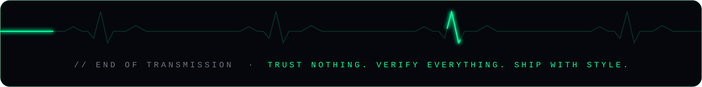

