

  <picture>
    <source media="(prefers-color-scheme: light)" srcset="assets/v2/banner-light.svg"/>
    
  </picture>

  

  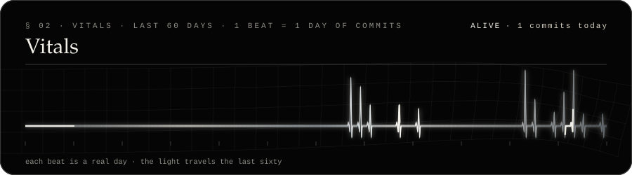

<h3 align="center"><code>§ 03 · LIVE DISSECTION</code></h3>

  

<h3 align="center"><code>§ 04 · OBSESSIONS</code></h3>

  

<h3 align="center"><code>§ 05 · CASE FILES</code></h3>

  <a href="https://github.com/njuj/unmask"></a>
  <a href="https://github.com/njuj/ghost-hunter"></a>
  <a href="https://github.com/njuj/driver-guard"></a>
  <a href="https://github.com/njuj/evtx-hunter"></a>
  <a href="https://github.com/njuj/panoptes"></a>
  <a href="https://github.com/njuj/unwrap"></a>

<code>▸ classified files (9 more)</code>

 

  <a href="https://github.com/njuj/harden-check"></a>
  <a href="https://github.com/njuj/provenance"></a>
  <a href="https://github.com/njuj/bundle-leak"></a>
  <a href="https://njuj.github.io/unseen/"></a>
  <a href="https://github.com/njuj/kira-scan"></a>
  <a href="https://github.com/njuj/slopcheck"></a>
  <a href="https://github.com/njuj/headerguard"></a>
  <a href="https://njuj.github.io/ioc-hunter/"></a>
  <a href="https://github.com/njuj/mailguard"></a>

<h3 align="center"><code>§ 06 · LATEST REPORTS</code></h3>

  <a href="reports/001-fake-fps-booster/"></a>
   
  <b>CASE #001</b> · <a href="reports/001-fake-fps-booster/">Fake FPS booster → njRAT + XWorm</a> · two delivery chains, both configs decrypted, nothing executed

<h3 align="center"><code>§ 07 · BODY COUNT</code></h3>

  
   
  

<h3 align="center"><code>§ 08 · ARSENAL</code></h3>

  

  

