<p align="center"></p>

# CASE #001: Dissecting a fake FPS booster

**From a ZIP to two RAT configurations, without running anything.**

> [!NOTE]
> **Lab replica.** The sample here is a rebuilt copy of a common gaming-scam chain. It was made for this write-up from inert test fixtures. The executables are compiled with the real C# compiler and keep the builder's config layout, but they contain no RAT code. Every host is a lab name or a documentation address (RFC 5737). The techniques, layouts and decryption steps are the same ones used in real njRAT and XWorm campaigns.

## TL;DR

| | |
|---|---|
| **Bait** | `FpsBooster_v2.1.zip`, shared as a free "FPS booster" for games |
| **Payload 1** | **njRAT 0.7d**, hidden in a .NET resource and XOR-encrypted with a 12-byte key |
| **Payload 2** | **XWorm 5.6**, hidden in the PE overlay of a second exe, as reversed base64 then gzip |
| **C2** | `kira-lab-c2[.]ddns[.]net:5552`, `kira-lab-c2[.]duckdns[.]org:7000`, plus a Telegram bot |
| **Persistence** | Run key named `Windows Update.exe` (njRAT); a copy in `%AppData%\XClient.exe` (XWorm) |
| **Time to config** | one command, 0.0 s, with [unmask](https://github.com/njuj/unmask) |

## 1. The bait

The ZIP looks like any "boost your FPS" tool posted in game Discords and YouTube comments:

```
FpsBooster_v2.1.zip            9,826 B
├── FpsBooster.exe             8,192 B   .NET, entry FpsBooster.Program::Main
└── tools/Updater.exe         11,308 B   .NET, entry FpsBooster.Program::Main
```

Two things stand out right away:

- **Both exes are the same program.** Same assembly name (`bait_booster`), same entry point, same resources.
- **`Updater.exe` is 3,116 bytes bigger.** Its sections end before the end of the file. Bytes after the last section are a PE **overlay**: the loader doesn't map them, so they are a classic hiding place.

So there are two chains to follow: whatever the shared loader hides in its resources, and whatever sits in that overlay.

## 2. Chain A: resource → XOR → njRAT

`FpsBooster.exe` has one managed resource, `FpsBooster.Properties.Resources.resources`, with 2 entries. One of them, `icon_data`, is 4,096 bytes of high-entropy noise. It isn't an icon.

**Getting the XOR key without guessing.** Almost every Windows executable starts with the same 60 bytes, the DOS header (`MZ`, `0x90`, ... up to `e_lfanew` at `0x3C`). If the blob is an XOR-encrypted exe, then `blob[i] XOR header[i]` gives the key stream directly:

```
blob     ⊕  4D 5A 90 00 03 00 00 00 04 00 00 00 FF FF 00 00 ...
         =  k  i  r  a  -  u  n  m  a  s  k  !  k  i  r  a  ...
```

The stream repeats every 12 bytes, so the key is `kira-unmask!`. To confirm it, decrypt `e_lfanew` and check that the 4 bytes it points to are `PE\0\0`. This works for any repeating key up to 30 bytes, and it doesn't need the key to appear anywhere in the loader.

The decrypted blob is a .NET exe, assembly `njrat_07d`, entry `j.OK::Main`. That is the njRAT 0.7d layout: every setting is a static field of class `OK`.

| Setting | Value |
|---|---|
| C2 | `kira-lab-c2[.]ddns[.]net:5552` (No-IP dynamic DNS) |
| Victim name | `HacKed` (stored as base64 `SGFjS2Vk`) |
| Version | `0.7d` |
| Separator | `\|'\|'\|` (splits every message between victim and C2) |
| Installed as | `Windows Update.exe` in `%TEMP%` |
| Registry key / mutex | `5cd8f17f4086744065eb0992a09e05a2` |
| Run-key persistence | yes |
| Copy to Startup folder | no |
| BSOD if killed | no |

## 3. Chain B: overlay → reversed base64 → gzip → XWorm

The 3,116 overlay bytes are pure printable text in the base64 alphabet, but they don't decode as written. The `=` padding sits at the **start**, which means the string has been reversed. Reversing it back and decoding gives `1F 8B 08`, a gzip header. After decompressing, it's another .NET exe: assembly `xworm_v5`, entry `Stub.Program::Main`.

XWorm keeps its settings in `Stub.Settings` as base64 strings encrypted with **AES-256-ECB**. The key isn't stored anywhere; it's derived from the mutex, which is stored in plain text:

```python
h   = md5(mutex.encode()).digest()   # 16 bytes
key = h[:15] + h + b"\0"             # 32 bytes, the way XWorm builds it
```

With the mutex `q8R2vT6yN4kP1mXw`, every field decrypts:

| Setting | Value |
|---|---|
| C2 | `kira-lab-c2[.]duckdns[.]org:7000` (Duck DNS), `198[.]51[.]100[.]23:7000` |
| Encryption key | `<123456789>` |
| Separator | `<Xwormmm>` |
| Group / build | `XWorm V5.6` |
| Mutex | `q8R2vT6yN4kP1mXw` |
| Installed as | `%AppData%\XClient.exe` |
| USB spreader name | `USB.exe` |
| Keylogger file | `\Log.tmp` |
| Sleep | 3 s |
| Telegram | bot `7310452291` (token truncated: `7310452291:AAH…`), chat `5207741936` |

The Telegram bot is how the operator gets a "new victim" message. It's also the weakest point of the whole setup, see [Takedown](#8-takedown).

## 4. One command

Everything above, done by hand, takes an analyst an hour or two in dnSpy and CyberChef. With [unmask](https://github.com/njuj/unmask) it is one static pass. Nothing gets executed:

```console
$ unmask FpsBooster_v2.1.zip --iocs iocs.txt --yara rules.yar

 CHAIN
 ① FpsBooster_v2.1.zip  ZIP, 2 file(s)  9,826 B
    └─② FpsBooster.exe  .NET exe, assembly "bait_booster"  8,192 B
       └─③ FpsBooster.Properties.Resources.resources  .NET resources, 2 entries
          └─④ icon_data  .NET exe, assembly "njrat_07d"  4,096 B  ✖ njRAT 0.7d
               from resource entry icon_data  ·  XOR (12-byte key "kira-unmask!")
    └─⑤ tools/Updater.exe  .NET exe, assembly "bait_booster"  11,308 B
       └─⑥ overlay (3,116 bytes after the last section)  .NET exe  5,120 B  ✖ XWorm 5.6
            from overlay  ·  reversed base64  →  gzip

 ✖ njRAT 0.7d configuration  ·  stage ④, class j.OK
   C2                               kira-lab-c2.ddns.net:5552  No-IP · dynamic DNS
   ...
 ✖ XWorm 5.6 configuration  ·  stage ⑥, class Stub.Settings
   decrypted with AES-256-ECB, key = MD5(mutex "q8R2vT6yN4kP1mXw") as XWorm derives it
   C2                               kira-lab-c2.duckdns.org:7000  Duck DNS · dynamic DNS
   ...

 ✖ XWorm, njRAT found  ·  3 C2 endpoint(s)
```

The exit code is `1` when a configuration is found (`0` none, `2` error), so it drops straight into a mail-gateway or sandbox pipeline.

## 5. Indicators

```
# C2
kira-lab-c2[.]ddns[.]net:5552
kira-lab-c2[.]duckdns[.]org:7000
198[.]51[.]100[.]23:7000

# Host
mutex / Run value   5cd8f17f4086744065eb0992a09e05a2
mutex               q8R2vT6yN4kP1mXw
files               %TEMP%\Windows Update.exe, %AppData%\XClient.exe, \Log.tmp, USB.exe
```

| Stage | SHA-256 |
|---|---|
| FpsBooster_v2.1.zip | `22582aa9e21917ff46f52d46125ffa4df7d7a5e70b21b7e79dd61a9804c877e0` |
| FpsBooster.exe | `0192cd98383a17fd6cb56c43c5c454765c911926b5dbeb208f2bf4cde3e0cdd4` |
| Resources blob | `e7c00e644af9bf422934448622bac2590e1cff2195d90f1d68b255e287a252ef` |
| icon_data (njRAT) | `0168b736c491281b9a697ba94166fe806f6248f5f549e13fbe5da6364d27ba86` |
| tools/Updater.exe | `e58da37439e7df0763c1c9bb33e37c0e68eee93907a6204201a2bb0bfd981946` |
| overlay (XWorm) | `7388d06ad5c3967556add9b88e03327a3246d4c7252d46cb747b1dc61f29145e` |

## 6. Detection

YARA rule unmask generated from the decrypted njRAT config (the values are stored as UTF-16 in .NET):

```yara
rule unmask_njRAT_0168b736c491
{
    meta:
        description = "njRAT 0.7d configuration values (unmask)"
        sha256 = "0168b736c491281b9a697ba94166fe806f6248f5f549e13fbe5da6364d27ba86"
    strings:
        $s0 = "SGFjS2Vk" wide
        $s1 = "kira-lab-c2.ddns.net" wide
        $s2 = "Windows Update.exe" wide
        $s3 = "5cd8f17f4086744065eb0992a09e05a2" wide
        $s4 = "|'|'|" wide
    condition:
        uint16(0) == 0x5A4D and (3 of them)
}
```

A matching rule for XWorm (the encrypted base64 values plus the mutex) is in unmask's `--yara` output.

**Where to hunt:**

- `HKCU\Software\Microsoft\Windows\CurrentVersion\Run` values named like a hex MD5, pointing into `%TEMP%`. Real Windows Update never lives there.
- Executables named `XClient.exe` in `%AppData%`, or `Windows Update.exe` anywhere outside `System32`.
- DNS lookups to `*.ddns.net` / `*.duckdns.org` from a process that isn't a browser.
- Outbound TCP to `5552` and `7000`. These are the builders' default ports, and almost nobody else uses them.
- `api.telegram.org` traffic from an unsigned process in a user folder.

## 7. MITRE ATT&CK

| Technique | Where |
|---|---|
| [T1204.002](https://attack.mitre.org/techniques/T1204/002/) User Execution: Malicious File | the victim runs the "booster" |
| [T1027](https://attack.mitre.org/techniques/T1027/) Obfuscated Files or Information | XOR resource, reversed base64 overlay |
| [T1140](https://attack.mitre.org/techniques/T1140/) Deobfuscate/Decode Files | loader decodes both stages at runtime |
| [T1547.001](https://attack.mitre.org/techniques/T1547/001/) Registry Run Keys | `Windows Update.exe` Run value |
| [T1036.005](https://attack.mitre.org/techniques/T1036/005/) Masquerading: Match Legitimate Name | `Windows Update.exe` |
| [T1056.001](https://attack.mitre.org/techniques/T1056/001/) Keylogging | XWorm `\Log.tmp` |
| [T1091](https://attack.mitre.org/techniques/T1091/) Replication Through Removable Media | XWorm `USB.exe` spreader |
| [T1095](https://attack.mitre.org/techniques/T1095/) Non-Application Layer Protocol | raw TCP C2 on 5552 / 7000 |
| [T1102](https://attack.mitre.org/techniques/T1102/) Web Service | Telegram bot notifications |

## 8. Takedown

No hack-back. Nobody connects to the C2 and nobody uses the bot token. Reports go to the people who can switch things off:

- **No-IP**: abuse report for the `ddns.net` hostname. The njRAT victims lose their C2 the moment it stops resolving.
- **Duck DNS**: report the subdomain to the operator.
- **Telegram**: send the bot ID (`7310452291`) to `abuse@telegram.org`. Don't call the API with the token.
- **abuse.ch**: submit the C2s and hashes to ThreatFox / URLhaus, so every blocklist picks them up.

## Takeaways

- **Overlays and resources are where .NET loaders hide stages.** Check the file size against the end of the last section, and look at every resource that is bigger than it should be.
- **XOR against a known header beats brute force.** 60 known bytes give you any key up to 30 bytes in one pass.
- **RAT configs are weaker than they look.** XWorm's AES key is the MD5 of a string sitting next to it in plain text.
- **Configs are the fastest path to takedown.** One hostname report cuts off every victim at once.

---

<sub>Analysed statically with [unmask](https://github.com/njuj/unmask) · no sample was executed · lab replica, indicators are not live · [← back to profile](https://github.com/njuj)</sub>
